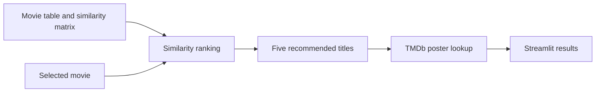

# Movie Recommendation System

**Choose a movie and explore five similar titles.**

A Streamlit interface backed by a precomputed movie-similarity matrix. The application retrieves recommended titles from local artifacts and uses TMDb to display their posters.

## How it helps

A familiar movie provides a useful starting point for discovery. This project connects a recommendation notebook to a simple interface so the retrieval step and result presentation are easy to follow.

## Recommendation flow

1. Select a title from the movie table.
2. Find the corresponding row in the similarity matrix.
3. Sort scores and select five neighboring titles, excluding the first ranked entry.
4. Fetch their poster images and display the results side by side.

The app serves precomputed similarities; it does not train or update a recommendation model while you use it.

## Setup and required artifacts

Use Python and install the app's dependencies:

```bash
python -m pip install streamlit pandas requests
```

Before launching, ensure both artifacts exist beside `app.py`:

| Artifact | Repository status |
|---|---|
| `movie_dict.pkl` | Included |
| `similarity.pkl` | Required by the app, not included in the current tree |

Use [`movie recommendation system.ipynb`](<movie recommendation system.ipynb>) to inspect the preparation workflow and provide the expected datasets and generated matrix. Configure your own TMDb access in `fetch_poster`; the source does not currently read a dedicated API-key environment variable.

```bash
python -m streamlit run app.py
```

## Architecture



## Project guide

[`app.py`](app.py) contains the UI, ranking, and poster lookup. The notebook holds the data-preparation experiments. Only load serialized artifacts from a trusted source and matching preparation workflow.

## Attribution

Movie data and posters are provided through [TMDb](https://www.themoviedb.org/). This application is not endorsed or certified by TMDb.
